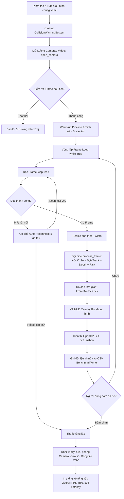

# Tài Liệu Kỹ Thuật: Giải Thích Toàn Bộ Script `tools/live.py`, Cơ Chế Demo, Đọc Kết Quả & Hướng Phát Triển

Tài liệu này cung cấp bản phân tích toàn diện và chi tiết nhất về kịch bản vận hành thực nghiệm thời gian thực [live.py](file:///c:/Users/hoang/Downloads/web/detect_potholes/tools/live.py) thuộc đề tài **"Hệ Thống Phát Hiện Vật Cản Đường Bộ và Cảnh Báo Sớm Thời Gian Thực Dựa Trên Mô Hình YOLO11n"**.

---

## 1. Giới Thiệu Tổng Quan

### 1.1. Mục đích của file `live.py`
Trong một hệ thống Hỗ trợ Lái xe Nâng cao (ADAS / FCW - Forward Collision Warning), việc huấn luyện ra mô hình nhận diện tốt (file trọng số `best.pt` của YOLO11n) mới chỉ là bước đầu tiên. Để ứng dụng vào thực tế, hệ thống bắt buộc phải có một **bộ thu nhận và điều phối luồng (Streaming Ingestion & Runtime Orchestrator)**.

File `tools/live.py` đóng vai trò là **giao diện thực thi trực tiếp (Live Execution Interface)** của toàn bộ đề tài:
- Nhận luồng video thời gian thực từ camera ngoài (phổ biến nhất là camera điện thoại thông minh truyền qua Wi-Fi nội bộ bằng giao thức HTTP/MJPEG hoặc RTSP) hoặc các tệp video hành trình (Dashcam MP4) được ghi lại từ trước.
- Điều tiết độ phân giải khung hình (Frame Rescaling / Decimation) để phù hợp với năng lực tính toán của phần cứng kiểm thử.
- Đẩy từng khung hình qua đường ống xử lý hoàn chỉnh [CollisionWarningSystem](file:///c:/Users/hoang/Downloads/web/detect_potholes/app/fcw/pipeline.py) (tích hợp YOLO11n, ByteTrack, Depth Anything V2, Ego-Motion, Risk Engine).
- Hiển thị cửa sổ đồ họa trực quan (OpenCV GUI) kèm bảng thông số HUD (Heads-Up Display) phản ánh tức thời: FPS, độ trễ từng module, vật thể nguy hiểm nhất (Primary Target), khoảng cách (Distance) và thời gian chạm trán (Time-To-Collision - TTC).
- Phát cảnh báo bằng âm thanh và lưu trữ dữ liệu đo đạc (Telemetry / Benchmark CSV) phục vụ việc đánh giá, nghiệm thu khoa học.

### 1.2. Triết lý thiết kế: Tách biệt mối quan tâm (Separation of Concerns)
Một điểm quan trọng trong kiến trúc của dự án là:
> **`tools/live.py` hoàn toàn KHÔNG viết lại bất kỳ logic thuật toán nào của việc nhận diện, bám vết hay tính toán va chạm.**
> 
> Thiết bị ngoại vi (điện thoại/camera) chỉ đơn thuần cung cấp các khung hình ảnh thô (raw frames). Mọi tác vụ suy luận AI, bám vết đối tượng, ước lượng bản đồ độ sâu và đánh giá rủi ro đều được ủy quyền cho module lõi `app.fcw.pipeline.CollisionWarningSystem`. Nhờ đó, mã nguồn `live.py` rất tinh gọn, ổn định, đóng vai trò như một bộ "vỏ bọc thực thi" (Runner / Harness) chuyên nghiệp.

---

## 2. Giải Thích Chi Tiết Toàn Bộ Mã Nguồn `live.py`

Mã nguồn của `live.py` dài 513 dòng, được tổ chức thành các khối module mạch lạc như sau:



---

### 2.1. Thiết lập môi trường và nạp thư viện (Dòng 1 – 45)
- **Dòng 1 – 17**: Docstring mô tả mục đích, cú pháp dòng lệnh mẫu (`CLI Usage`) và lưu ý vận hành.
- **Dòng 19 – 29**: Import các thư viện tiêu chuẩn của Python (`argparse`, `csv`, `os`, `sys`, `time`, `deque`, `datetime`, `Path`) và thư viện thị giác máy tính OpenCV (`cv2`).
- **Dòng 30 – 37 (Project Root Setup)**:
  ```python
  ROOT = Path(__file__).resolve().parent.parent
  sys.path.insert(0, str(ROOT))
  os.chdir(ROOT)
  ```
  *Ý nghĩa kỹ thuật*: Đoạn mã này lấy thư mục cha của thư mục chứa `live.py` (tức thư mục gốc của dự án `detect_potholes`) để đưa vào đầu danh sách tìm kiếm module của Python (`sys.path.insert(0, ...)`) và chuyển thư mục làm việc hiện tại (`os.chdir(ROOT)`). Điều này đảm bảo khi người dùng chạy script từ bất kỳ đâu (ví dụ đứng từ `tools/` hay đứng từ ổ đĩa khác), chương trình luôn tìm thấy đúng các gói nội bộ (`app.fcw.*`), tệp cấu hình `config.yaml` và trọng số mô hình `assets/best.pt`.
- **Dòng 38 – 44**: Định nghĩa các hằng số cấu hình:
  - `WINDOW_NAME = "Road Obstacle & FCW Demo"`: Tên cửa sổ OpenCV.
  - `MAX_RECONNECT_ATTEMPTS = 5`: Số lần thử kết nối lại tối đa khi luồng camera bị ngắt.
  - `DEFAULT_RECONNECT_DELAY = 2.0`: Thời gian chờ (giây) giữa các lần thử kết nối lại.
  - `FPS_WINDOW_SIZE = 30`: Kích thước cửa sổ trượt (30 khung hình) dùng để tính FPS tức thời.
  - `BENCHMARK_DIR = "runs"`: Thư mục chứa các tệp nhật ký đo kiểm CSV.

---

### 2.2. Trình phân tích tham số dòng lệnh CLI (Dòng 47 – 104)
Hai hàm `build_parser()` và `validate_args()` đảm nhận việc xử lý giao diện người dùng qua terminal:
- **`build_parser()`**: Khởi tạo đối tượng `argparse.ArgumentParser`. Thiết kế tại đây tuân thủ nguyên tắc: **Không tải mô hình AI hoặc mở kết nối mạng bên trong hàm build_parser**. Nhờ vậy, khi người dùng gõ `python tools/live.py --help`, trợ giúp hiển thị ngay lập tức trong vài mili-giây mà không làm đơ terminal.
  - `--url` (Bắt buộc): Đường dẫn luồng video IP (ví dụ: `http://192.168.1.42:8080/video`) hoặc đường dẫn tệp video hành trình (ví dụ: `dashcam.mp4`).
  - `--width` (Mặc định `0`): Chiều rộng ảnh mục tiêu để nén/thu nhỏ (downscale). Nếu đặt `960` hoặc `640`, chiều cao sẽ tự động co giãn theo đúng tỷ lệ khung hình. Nếu đặt `0`, giữ nguyên kích thước gốc của camera.
  - `--config` (Mặc định `config.yaml`): Đường dẫn tệp cấu hình hệ thống.
  - `--reconnect` (Mặc định `5`): Số lần thử kết nối lại.
  - `--reconnect-delay` (Mặc định `2.0`): Khoảng nghỉ giữa các lần kết nối lại.
  - `--benchmark` (Cờ nhị phân): Bật tính năng ghi nhật ký đo đạc từng khung hình vào tệp CSV.
  - `--no-display` (Cờ nhị phân): Chế độ chạy không giao diện (headless mode), tắt toàn bộ hiển thị cửa sổ OpenCV để đo tốc độ suy luận thuần túy (throughput tối đa).
- **`validate_args(args)`**: Kiểm tra tính hợp lệ logic của các đối số (URL không được rỗng, các giá trị kích thước, số lần reconnect không được là số âm) trước khi chuyển sang bước khởi tạo nặng.

---

### 2.3. Lớp đo lường hiệu năng `FrameMetrics` (Dòng 107 – 176)
Để hệ thống phản ánh đúng chất lượng thời gian thực, việc đo FPS và độ trễ phải cực kỳ chính xác. Lớp `FrameMetrics` được xây dựng với các đặc tính:
- Sử dụng cấu trúc hàng đợi hai đầu có giới hạn phần tử `collections.deque(maxlen=30)`:
  - `self._times`: Lưu mốc thời gian hoàn thành các khung hình gần nhất.
  - `self._pipeline_ms`: Lưu tổng thời gian xử lý toàn bộ pipeline của từng khung hình.
  - `self._yolo_ms`, `self._depth_ms`: Lưu riêng thời gian suy luận của module YOLO11n và mô hình độ sâu Depth Anything V2.
- Sử dụng đồng hồ đơn điệu `time.perf_counter()`: Đây là đồng hồ có độ phân giải cao nhất trong Python, không bị ảnh hưởng bởi việc đồng bộ giờ hệ thống hay bước nhảy múi giờ (NTP updates).
- **Công thức tính Sliding-Window FPS**:
  $$\text{sliding\_fps} = \frac{N - 1}{t_{\text{last}} - t_{\text{first}}} \quad (N = \text{len}(times) \ge 2)$$
  *Ưu điểm*: Khác với cách tính FPS tức thời theo từng khung hình riêng lẻ ($\frac{1}{\Delta t}$) vốn bị dao động rất mạnh (flickering), công thức cửa sổ trượt 30 frames cho ra giá trị FPS ổn định, mượt mà và đại diện chân thực cho trải nghiệm quan sát của người dùng.
- **Công thức tính Overall FPS**:
  $$\text{overall\_fps} = \frac{\text{total\_frames}}{t_{\text{current}} - t_{\text{start}}}$$
  Phản ánh tốc độ xử lý trung bình xuyên suốt toàn bộ phiên chạy từ đầu đến cuối.
- **Độ trễ phân vị (Percentiles p50 và p95)**:
  Sử dụng hàm `numpy.percentile` trên danh sách độ trễ:
  - `p50_pipeline_ms`: Trung vị (50% khung hình xử lý nhanh hơn mức này).
  - `p95_pipeline_ms`: Phân vị 95 (độ trễ rơi vào 5% trường hợp xấu nhất). Đây là chỉ số quan trọng trong các hệ thống an toàn xe hơi (ADAS), giúp phát hiện các hiện tượng giật cục khung hình (jitter / frame drop do cơ chế dọn rác bộ nhớ Garbage Collection hoặc nghẽn GPU).

---

### 2.4. Lớp ghi dữ liệu vi mô `BenchmarkWriter` (Dòng 178 – 202)
Khi bật cờ `--benchmark`, mỗi khung hình được xử lý sẽ tự động được ghi lại 1 dòng vào tệp CSV với định dạng tên `runs/live_benchmark_YYYYMMDD_HHMMSS.csv`.
Bao gồm 16 cột thông số chi tiết:
1. `frame`: Số thứ tự khung hình (bắt đầu từ 1).
2. `timestamp`: Mốc thời gian Unix (giây) tại thời điểm nhận khung hình.
3. `src_w`, `src_h`: Kích thước gốc của camera (ví dụ: $1920 \times 1080$).
4. `proc_w`, `proc_h`: Kích thước sau khi co giãn đưa vào xử lý (ví dụ: $960 \times 540$).
5. `loop_fps`: FPS cửa sổ trượt tại khung hình đó.
6. `pipeline_ms`: Tổng thời gian thực thi toàn bộ pipeline (ms).
7. `yolo_ms`: Thời gian suy luận YOLO11n + ByteTrack (ms).
8. `depth_ms`: Thời gian suy luận mô hình ước lượng độ sâu (ms) (chỉ xuất hiện ở những khung hình chạy depth thật, các khung hình nội suy sẽ để trống).
9. `detections`: Số lượng hộp bao vật cản phát hiện được.
10. `tracks`: Số lượng đối tượng đang duy trì quỹ đạo bám vết hợp lệ.
11. `level`: Mức độ cảnh báo rủi ro hiện thời (`NORMAL`, `WARNING`, `DANGER`).
12. `primary_class`: Tên lớp đối tượng nguy hiểm nhất (ví dụ: `motorbike`, `car`, `person`, `pothole`).
13. `primary_distance_m`: Khoảng cách ước tính đến đối tượng nguy hiểm nhất (mét).
14. `primary_ttc_s`: Thời gian chạm trán dự tính đến đối tượng đó (giây).

---

### 2.5. Xử lý kết nối Camera mạng (Dòng 204 – 226)
- **`open_camera(url, timeout_sec=15)`**: Khởi tạo đối tượng `cv2.VideoCapture(url)`. Sau khi kiểm tra `isOpened()`, hàm **chủ động đọc thử 1 frame mồi (`cap.read()`)**.
  *Kinh nghiệm kỹ thuật*: Với các luồng mạng qua Wi-Fi (HTTP MJPEG hoặc RTSP), đôi khi lệnh bắt tay TCP socket ban đầu thành công (`isOpened() == True`), nhưng luồng dữ liệu hình ảnh lại bị kẹt hoặc camera chưa sẵn sàng. Việc đọc thử 1 frame đảm bảo xác thực luồng dữ liệu hình ảnh thực sự thông suốt.
- **`get_frame_size(cap, frame)`**: Lấy kích thước ảnh từ mảng NumPy của frame thực tế (`frame.shape[:2]`), chỉ dùng `cap.get(cv2.CAP_PROP_FRAME_WIDTH)` làm phương án dự phòng. Lý do là phần lớn camera mạng khi truyền qua giao thức MJPEG sẽ trả về giá trị 0 hoặc không chính xác đối với thuộc tính `CAP_PROP_FRAME_WIDTH`.

---

### 2.6. Thiết kế bảng thông tin HUD Overlay (Dòng 228 – 289)
Hàm `draw_overlay(...)` chịu trách nhiệm vẽ bảng điều khiển bán trong suốt trực tiếp lên khung hình:
- **Tự động căn chỉnh kích thước HUD**: Sử dụng hàm `cv2.getTextSize` để tính toán độ dài chuỗi văn bản dài nhất, từ đó tự động vẽ một hộp nền màu xám đen (`RGB: (20, 20, 20)`) viền xám (`RGB: (80, 80, 80)`) ôm trọn văn bản. Điều này đảm bảo chữ số luôn đọc được rõ ràng, không bị lẫn vào nền đường nhựa tối hoặc xe cộ nhiều màu.
- **Mã hóa màu sắc cảnh báo rủi ro**:
  - Dòng trạng thái đối tượng chính (`Primary`) sẽ tự động đổi màu:
    - **DANGER**: Đỏ tươi (`BGR: (0, 0, 255)`).
    - **WARNING**: Cam vàng (`BGR: (0, 165, 255)`).
    - **NORMAL**: Trắng xám (`BGR: (230, 230, 230)`).
- **`draw_reconnect_status(...)`**: Khi luồng video bị đứt, hàm này sẽ hiển thị màn hình thông báo rõ ràng: số lần thử hiện tại / tổng số lần thử (`Reconnecting... (1/5) Next in 2s`), giúp người xem demo hiểu ngay rằng hệ thống đang tự động khôi phục mạng chứ không phải chương trình bị treo (freeze).

---

### 2.7. Vòng lặp điều phối chính `main()` (Dòng 292 – 510)
Trình tự thực thi logic của `main()` diễn ra chặt chẽ:
1. **Phân tích tham số & Kiểm tra hợp lệ**: Nếu có lỗi, in cảnh báo ra `sys.stderr` và thoát với mã lỗi 1.
2. **Khởi tạo Pipeline trước khi mở Camera**:
   - Tải tệp cấu hình `load_config(args.config)`.
   - Khởi tạo hệ thống `CollisionWarningSystem(cfg)`: Tại thời điểm này, mô hình YOLO11n (`assets/best.pt`) và mô hình độ sâu được nạp lên bộ nhớ (GPU nếu có CUDA hoặc CPU), bộ lọc âm thanh và visualizer được thiết lập.
3. **Mở Camera & Tính toán tỷ lệ co giãn (Scaling)**:
   - Nếu người dùng truyền `--width 960` và camera gốc là `1920`, hệ số scale được tính $scale = \frac{960}{1920} = 0.5$.
   - Kích thước xử lý: $960 \times 540$. Kích thước này giúp giảm khối lượng pixel cần xử lý xuống còn $25\%$, tăng tốc độ khung hình lên gấp nhiều lần.
4. **Vòng lặp xử lý liên tục (`while True`)**:
   - `cap.read()`: Lấy khung hình mới.
   - **Xử lý mất kết nối (Stream Reconnection)**: Nếu `ok is False`, kích hoạt vòng lặp thử lại (`attempt` từ 1 đến `max_reconnect`). Hệ thống ngủ ngắt quãng theo `reconnect_delay`, đồng thời vẫn lắng nghe phím `q` hoặc `Esc` nếu người dùng muốn dừng ngang. Nếu kết nối lại thành công, luồng tiếp tục bình thường; nếu quá số lần thử, dừng an toàn.
   - **Nén ảnh**: Sử dụng thuật toán nội suy `cv2.INTER_AREA` (thuật toán tối ưu nhất để thu nhỏ ảnh mà không gây hiện tượng răng cưa/aliasing cho các cạnh mỏng của vật cản nhỏ như chóp nón hoặc ổ gà).
   - **Xử lý qua Pipeline**:
     ```python
     result = pipe.process_frame(frame, now)
     drawn, res = result[0], result[1]
     ```
     Nhận lại ảnh đã vẽ hộp bao/vết bám (`drawn`) và từ điển metadata (`res`).
   - **Ghi nhận thời gian & Cập nhật chỉ số**: Gọi `metrics.tick(...)`.
   - **Hiển thị & Bắt phím tắt**: Vẽ HUD và hiển thị `cv2.imshow()`, chờ 1ms bắt phím `q` hoặc `Esc` để thoát.
   - **Ghi Benchmark**: Đẩy dữ liệu vào tệp CSV nếu tính năng benchmark được bật.
5. **Khối an toàn `finally`**:
   Đảm bảo giải phóng toàn bộ tài nguyên phần cứng ngay cả khi người dùng nhấn `Ctrl+C` hoặc xảy ra lỗi đột ngột:
   - `cap.release()`: Đóng luồng video capture.
   - `cv2.destroyAllWindows()`: Thu hồi các cửa sổ đồ họa OpenCV.
   - `pipe.close()`: Đóng các luồng worker nội bộ, giải phóng mô hình và bộ đệm âm thanh.
   - `benchmark.close()`: Đóng file CSV an toàn, tránh mất mát dữ liệu chưa ghi (flush buffer).
6. **In báo cáo tóm tắt ra Terminal**:
   In tổng số khung hình đã xử lý, tổng thời gian chạy, FPS trung bình toàn khóa, cùng giá trị độ trễ phân vị `p50` và `p95`.

---

## 3. Cơ Chế Demo Thực Nghiệm

Phần này hướng dẫn chi tiết cách chuẩn bị và triển khai một buổi demo hoàn chỉnh, trực quan cho hội đồng thẩm định hoặc người quan sát.

### 3.1. Mô hình kiến trúc Demo
Hệ thống demo tận dụng điện thoại thông minh cá nhân đóng vai trò như một **Camera thông minh hành trình (Smart Dashcam)** gắn trên kính lái ô tô hoặc tay lái xe máy:

```
┌─────────────────────────────────┐                 ┌──────────────────────────────────────┐
│       SMARTPHONE (Android)      │                 │            MÁY TÍNH / TRẠM XỬ LÝ     │
│  - Ứng dụng: IP Webcam          │   Wi-Fi LAN     │  - tools/live.py                     │
│  - Camera: 1080p / 720p 30fps   │ ──────────────> │  - Pipeline: YOLO11n + Depth + FCW   │
│  - Stream HTTP: /video (MJPEG)  │  (Không cần 4G) │  - Cửa sổ hiển thị thời gian thực    │
└─────────────────────────────────┘                 └──────────────────────────────────────┘
```

### 3.2. Các bước thiết lập trước buổi Demo
1. **Kết nối mạng**: Cả điện thoại và máy tính chạy demo phải kết nối vào **cùng một mạng Wi-Fi** (hoặc điện thoại bật tính năng "Điểm phát sóng di động" - Hotspot để máy tính kết nối trực tiếp vào điện thoại, đây là giải pháp tốt nhất khi demo ngoài trời vì không bị phụ thuộc vào router tòa nhà).
2. **Cấu hình trên điện thoại (Ứng dụng IP Webcam)**:
   - Tải ứng dụng **IP Webcam** miễn phí từ Google Play Store.
   - Mở ứng dụng, cuộn xuống mục **Video preferences**:
     - *Video resolution*: Chọn `1280x720` (hoặc `960x540` nếu máy tính cấu hình yếu).
     - *Quality*: Để khoảng `50%` đến `60%` (vừa đủ nét, giảm độ trễ truyền gói tin mạng).
   - Cuộn xuống đáy màn hình và chọn **Start server**.
   - Màn hình điện thoại sẽ hiện địa chỉ IP cục bộ, ví dụ: `http://192.168.1.42:8080`.
   - Luồng video trực tiếp của ứng dụng này nằm tại đường dẫn: `http://192.168.1.42:8080/video`.

### 3.3. Các lệnh chạy Demo tiêu chuẩn

#### Kịch bản 1: Chạy Demo trực tiếp qua Camera điện thoại (Khuyên dùng)
```bash
# Kích hoạt môi trường ảo
source .venv/bin/activate   # Trên Linux/macOS
.venv\Scripts\activate      # Trên Windows PowerShell

# Chạy với độ phân giải nén 960px để đảm bảo FPS mượt mà
python tools/live.py --url "http://192.168.1.42:8080/video" --width 960
```

#### Kịch bản 2: Demo dự phòng bằng Video hành trình có sẵn (Khi không có Wi-Fi)
Nếu phòng họp/hội đồng không có Wi-Fi hoặc sóng mạng bị can nhiễu, sử dụng ngay video hành trình đường bộ đã quay trước làm nguồn thay thế:
```bash
python tools/live.py --url "assets/demo_road_traffic.mp4" --width 960
```
*Lợi ích*: Đảm bảo buổi báo cáo luôn thành công 100%, không bị phụ thuộc vào yếu tố khách quan của đường truyền không dây.

#### Kịch bản 3: Chạy chế độ Đo kiểm Benchmark khoa học
Để trích xuất dữ liệu thực nghiệm phục vụ việc vẽ đồ thị trong bài báo/luận văn:
```bash
python tools/live.py --url "http://192.168.1.42:8080/video" --width 960 --benchmark
```
Sau khi chạy xong và bấm phím `q`, tệp `runs/live_benchmark_YYYYMMDD_HHMMSS.csv` sẽ được sinh ra với đầy đủ thông số từng frame.

---

## 4. Hướng Dẫn Đọc và Phân Tích Kết Quả

Trong suốt quá trình demo hoặc thực nghiệm, kết quả trả về qua hai kênh chính: **Giao diện trực quan HUD (Visual Overlay)** và **Nhật ký số liệu đo kiểm (Benchmark CSV / Terminal Logs)**.

### 4.1. Cách đọc thông số trên màn hình HUD Overlay
Bảng điều khiển HUD ở góc trên bên trái khung hình hiển thị 4 dòng dữ liệu then chốt:

```
┌────────────────────────────────────────────────────────────────────────┐
│ Loop FPS:  18.4  |  Overall:  17.9                                     │
│ Pipeline:  54.2ms  |  YOLO:   18ms  |  Depth:  120ms                   │
│ Source: 1280x720 -> 960x540  |  Det: 4  Tracks: 3                      │
│ Primary: motorbike  Dist: 5.8m  TTC: 2.14s  [WARNING]                  │
└────────────────────────────────────────────────────────────────────────┘
```

1. **Dòng 1: Đánh giá tính Thời gian thực (Real-time Capabilities)**
   - `Loop FPS`: Tốc độ xử lý thực tế tính trên 30 khung hình gần nhất. Đối với hệ thống cảnh báo va chạm hỗ trợ lái xe, tốc độ $\ge 15\text{ FPS}$ được coi là đạt yêu cầu phản xạ; từ $20 - 30\text{ FPS}$ là mức lý tưởng.
   - `Overall`: Tốc độ trung bình kể từ khi bấm chạy. Cho phép đánh giá độ ổn định nhiệt độ phần cứng (xem sau 5-10 phút máy có bị hiện tượng giảm hiệu năng do quá nhiệt - thermal throttling hay không).
2. **Dòng 2: Phân tích Nút cổ chai Hiệu năng (Latency Bottleneck)**
   - `Pipeline`: Tổng thời gian một khung hình đi qua toàn bộ các bước: tiền xử lý $\to$ YOLO11n $\to$ ByteTrack $\to$ Depth $\to$ Risk Engine $\to$ Giao diện.
   - `YOLO`: Thời gian suy luận của riêng mô hình YOLO11n. Mô hình kích thước nano (`yolo11n`) trên CPU hiện đại chỉ mất khoảng $15 - 25\text{ ms}$, trên GPU chỉ mất $4 - 8\text{ ms}$.
   - `Depth`: Thời gian ước lượng bản đồ độ sâu monocular của mô hình Depth Anything V2. Đây là thành phần tốn tài nguyên nhất (chiếm tới $70 - 80\%$ thời gian xử lý nếu chạy liên tục). Nhờ cơ chế `depth.interval: 5` trong cấu hình, cứ 5 khung hình mô hình độ sâu mới chạy 1 lần, các khung hình xen kẽ được bù đắp bằng nội suy tuyến tính, giúp duy trì FPS tổng thể ở mức cao.
3. **Dòng 3: Thống kê Đối tượng & Thị giác máy tính**
   - `Source -> Process`: Thể hiện độ phân giải gốc được co giãn thành độ phân giải tính toán (ví dụ: $1280 \times 720 \to 960 \times 540$).
   - `Det`: Số lượng hộp bao vật cản (Bounding Boxes) mà YOLO11n phát hiện được tại khung hình hiện tại (vượt qua ngưỡng tin cậy `conf_threshold: 0.45`).
   - `Tracks`: Số lượng vật thể được bộ theo dõi ByteTrack gán ID ổn định qua các khung hình liên tiếp.
4. **Dòng 4: Tình trạng Cảnh báo Va chạm Sớm (FCW Assessment)**
   - `Status: NORMAL`: Mọi vật thể ở khoảng cách an toàn, không có nguy cơ va chạm.
   - `Primary: [class] Dist: [X]m TTC: [Y]s [LEVEL]`:
     - `Primary class`: Tên vật thể có nguy cơ va chạm cao nhất đang nằm trực diện trong hành lang cảnh báo của xe (chẳng hạn xe máy `motorbike` hoặc ô tô `car` đang phanh gấp phía trước, hoặc ổ gà `pothole` kích thước lớn ở khoảng cách gần).
     - `Dist`: Khoảng cách ước tính từ đầu xe đến vật thể (mét).
     - `TTC` (Time-to-Collision): Thời gian dự kiến xảy ra va chạm nếu phương tiện tiếp tục duy trì tốc độ tiếp cận hiện tại.
     - `LEVEL`:
       - `NORMAL` (Màu trắng): An toàn ($TTC > 4.0\text{s}$ và $d > 8.0\text{m}$).
       - `WARNING` (Màu cam): Cảnh báo sớm ($2.0\text{s} < TTC \le 4.0\text{s}$ hoặc $3.5\text{m} < d \le 8.0\text{m}$). Người lái cần chú ý giảm tốc độ.
       - `DANGER` (Màu đỏ): Nguy hiểm khẩn cấp ($TTC \le 2.0\text{s}$ hoặc $d \le 3.5\text{m}$). Còi âm thanh kêu dồn dập, yêu cầu phanh khẩn cấp để tránh va chạm.

### 4.2. Cách đọc và khai thác tệp `live_benchmark_*.csv`
Tệp CSV sinh ra trong thư mục `runs/` có thể được mở trực tiếp bằng Microsoft Excel, Pandas hoặc Jupyter Notebook để vẽ các đồ thị học thuật:
- **Đồ thị phân bố độ trễ (Latency Distribution)**: Vẽ biểu đồ cột (Histogram) cột `pipeline_ms` và `yolo_ms` để chứng minh tính ổn định của mô hình.
- **Đồ thị tiếp cận khoảng cách & TTC theo thời gian**: Trục hoành là `timestamp` (hoặc `frame`), trục tung là `primary_distance_m` và `primary_ttc_s`. Đồ thị sẽ cho thấy đường cong giảm dần của khoảng cách khi xe tiến lại gần vật cản và sự chuyển cấp chính xác của cột `level` từ `NORMAL` sang `WARNING` và `DANGER`.

### 4.3. Đọc báo cáo tổng kết trên Terminal khi kết thúc
Khi người dùng bấm `q` để thoát chương trình, terminal in ra thông số tóm tắt:
```text
Done: 842 frames in 46.2s (18.2 FPS overall)
Pipeline p50: 52.4ms  p95: 68.1ms
Benchmark saved: runs/live_benchmark_20261015_154512.csv
```
- `Done: 842 frames in 46.2s (18.2 FPS)`: Tổng số khung hình xử lý được và tốc độ trung bình toàn phiên.
- `Pipeline p50: 52.4ms`: $50\%$ số khung hình có tổng thời gian xử lý dưới $52.4\text{ ms}$.
- `Pipeline p95: 68.1ms`: $95\%$ số khung hình có tổng thời gian xử lý dưới $68.1\text{ ms}$. Độ trễ tối đa (Worst-case latency) không vượt quá $70\text{ ms}$, chứng minh hệ thống có tính dự đoán cao (deterministic behavior), đáp ứng tiêu chuẩn của các ứng dụng thời gian thực mềm (Soft Real-Time Systems).

---

## 5. Hướng Phát Triển và Nâng Cấp Hệ Thống

Dựa trên kiến trúc hiện tại của `live.py` và đường ống `CollisionWarningSystem`, các hướng nâng cấp và mở rộng khả năng triển khai trong tương lai bao gồm:

### 5.1. Tối ưu hóa mô hình AI trên Phần cứng Nhúng Biên (Edge AI Deployment)
- **Chuyển đổi trọng số sang TensorRT / OpenVINO**:
  Hiện tại mô hình `best.pt` của YOLO11n chạy qua thư viện PyTorch/Ultralytics trên CPU/GPU thông thường. Bước tiếp theo là lượng tử hóa (Quantization) mô hình sang định dạng **FP16** hoặc **INT8** bằng TensorRT (trên các dòng máy tính nhúng NVIDIA Jetson Orin Nano / AGX) hoặc OpenVINO (trên bộ tăng tốc Intel NPU). Việc này có thể đẩy tốc độ suy luận của YOLO11n lên tới hơn **$100\text{ FPS}$** với mức tiêu thụ điện năng dưới $15\text{W}$.
- **Tối ưu hóa mô hình Depth Monocular**:
  Thay thế mô hình Depth Anything V2 kích thước tiêu chuẩn bằng phiên bản siêu nhẹ được tinh chỉnh riêng cho đường bộ (Depth-Anything-V2-Nano hoặc FastDepth), hoặc huấn luyện một nhánh dự đoán khoảng cách trực tiếp (Direct Distance Regression Head) gắn vào kiến trúc YOLO11n, loại bỏ hoàn toàn sự phụ thuộc vào mô hình depth thứ hai để tiết kiệm tài nguyên.

### 5.2. Dung hợp Cảm biến Phần cứng (Hardware Sensor Fusion)
- **Tích hợp giao tiếp CAN-Bus ô tô**:
  Hiện tại tốc độ phương tiện chủ ($v_{ego}$) đang được ước lượng xấp xỉ bằng thuật toán dòng quang học (Sparse Optical Flow). Để nâng cấp thành hệ thống chuẩn sản xuất (Production ADAS), hệ thống cần kết nối trực tiếp với cổng **OBD-II / CAN-Bus** của xe hơi để đọc chính xác tuyệt đối vận tốc xe từ cảm biến bánh xe và góc đánh lái vô lăng (Steering Angle).
- **Kết hợp Cảm biến Đo xa (LiDAR Mini / mmWave Radar)**:
  Bổ sung radar sóng milimet (77GHz mmWave Radar) hoặc cảm biến LiDAR đơn tia (Solid-State LiDAR). Radar có ưu điểm hoạt động hoàn hảo trong mọi điều kiện thời tiết (mưa lớn, sương mù, ban đêm chói lóa). Thị giác máy tính YOLO11n đảm nhận vai trò **phân loại vật cản** (đây là xe máy hay ổ gà), trong khi Radar/LiDAR đảm nhận việc **đo khoảng cách và vận tốc tương đối tuyệt đối**.

### 5.3. Tái cấu trúc Luồng Xử lý Bất đồng bộ (Asynchronous Multi-Threaded Pipeline)
- Kiến trúc hiện tại của `live.py` là một vòng lặp tuần tự (Synchronous Loop): Đọc frame $\to$ Xử lý $\to$ Hiển thị. Nếu một khung hình gặp hiện tượng lag mạng hoặc suy luận depth lâu, khung hình tiếp theo sẽ bị trễ.
- Hướng nâng cấp là chuyển sang mô hình **Nhà sản xuất - Người tiêu thụ (Producer-Consumer Architecture)** sử dụng hàng đợi đa luồng (`threading` hoặc `multiprocessing`):
  - *Luồng 1 (Camera Ingestion Worker)*: Chuyên đọc frame với tốc độ tối đa của camera (30/60 FPS) và chỉ giữ lại frame mới nhất trong bộ đệm (drop oldest frames để triệt tiêu hoàn toàn độ trễ truyền hình ảnh).
  - *Luồng 2 (AI Inference Worker)*: Lấy frame mới nhất chạy YOLO11n và ByteTrack.
  - *Luồng 3 (Display & Warning Worker)*: Cập nhật giao diện HUD và phát âm thanh cảnh báo độc lập.

### 5.4. Bản đồ Số Ổ gà & Kết nối Đám mây (Crowdsourced Pothole Cloud Mapping)
- Vì mô hình YOLO11n đã được huấn luyện nhận diện cả lớp `pothole` (ổ gà) và các chướng ngại vật mặt đường (`reflective_cone`, `warning_column`), hệ thống có thể tích hợp mô-đun **GPS định vị toàn cầu**.
- Khi phát hiện ổ gà với độ tin cậy cao ($conf > 0.7$) tại cự ly gần, hệ thống tự động ghi lại tọa độ GPS (kinh độ, vĩ độ) cùng kích thước ước lượng, sau đó gửi gói tin telemetry qua mạng 4G/5G về máy chủ đám mây. Dữ liệu này được tổng hợp thành **Bản đồ cảnh báo ổ gà thời gian thực (Crowdsourced Hazard Map)**, tự động cảnh báo cho các phương tiện khác khi chuẩn bị di chuyển vào đoạn đường hư hỏng.

### 5.5. Giao diện Cảnh báo Đa phương thức (Multimodal HMI)
- Nâng cấp còi báo đơn âm hiện tại thành **cảnh báo hiển thị trên kính lái (HUD Projector)** hoặc tích hợp qua màn hình trung tâm **Android Auto / Apple CarPlay**.
- Bổ sung cảnh báo xúc giác (Haptic Feedback) bằng cách kích hoạt mô-tơ rung gắn trên vô lăng hoặc đệm ghế lái, giúp lái xe phản xạ tức thì ngay cả khi đang bật nhạc lớn trong xe.
