# Tài Liệu Kỹ Thuật: Giải Thích Toàn Bộ Script `tools/live.py`, Luồng Pipeline, Phân Rã Chức Năng, Logic Phân Cấp Cảnh Báo & Đo Lường Hiệu Năng

Tài liệu này cung cấp bản phân tích chuyên sâu và toàn diện nhất về kịch bản vận hành thực nghiệm thời gian thực [live.py](file:///c:/Users/hoang/Downloads/web/detect_potholes/tools/live.py) và đường ống cảnh báo va chạm [app/fcw/](file:///c:/Users/hoang/Downloads/web/detect_potholes/app/fcw) thuộc đề tài **"Hệ Thống Phát Hiện Vật Cản Đường Bộ và Cảnh Báo Sớm Thời Gian Thực Dựa Trên Mô Hình YOLO11n"**.

---

## MỤC LỤC
1. [Tổng Quan Về `tools/live.py`](#1-tong-quan-ve-toolslivepy)
2. [Sơ Đồ Kiến Trúc & Luồng Pipeline Thực Thi](#2-so-do-kien-truc--luong-pipeline-thuc-thi)
3. [Phân Rã Chức Năng Từng File & Hàm Trong Hệ Thống](#3-phan-ra-chuc-nang-tung-file--ham-trong-he-thong)
   - [3.1. File `tools/live.py` (Bộ điều phối luồng ngoài)](#31-file-toolslivepy-bo-dieu-phoi-luong-ngoai)
   - [3.2. File `app/fcw/pipeline.py` (Trọng tâm điều phối đường ống FCW)](#32-file-appfcwpipelinepy-trong-tam-dieu-phoi-duong-ong-fcw)
   - [3.3. File `app/fcw/detector.py` (Nhận diện vật thể & Bám vết)](#33-file-appfcwdetectorpy-nhan-dien-vat-the--bam-vet)
   - [3.4. File `app/fcw/depth.py` (Ước lượng độ sâu khoảng cách Metric)](#34-file-appfcwdepthpy-uoc-luong-do-sau-khoang-cach-metric)
   - [3.5. File `app/fcw/tracking.py` (Động học, Vận tốc tiếp cận & Ego-Motion)](#35-file-appfcwtrackingpy-dong-hoc-van-toc-tiep-can--ego-motion)
   - [3.6. File `app/fcw/risk.py` (Động cơ phân tích rủi ro & Đánh giá va chạm)](#36-file-appfcwriskpy-dong-co-phan-tich-rui-ro--danh-gia-va-cham)
   - [3.7. File `app/fcw/audio.py` (Bộ phát cảnh báo âm thanh đa luồng)](#37-file-appfcwaudiopy-bo-phat-canh-bao-am-thanh-da-luong)
   - [3.8. File `app/fcw/visualizer.py` (Giao diện hiển thị đồ họa thị giác)](#38-file-appfcwvisualizerpy-giao-dien-hien-thi-do-hoa-thi-giac)
   - [3.9. File `config.yaml` (Tệp tham số cấu hình trung tâm)](#39-file-configyaml-tep-tham-so-cau-hinh-trung-tam)
4. [Logic Tính Toán Phân Cấp Cảnh Báo (Risk Level Assessment Logic)](#4-logic-tinh-toan-phan-cap-canh-bao-risk-level-assessment-logic)
   - [4.1. Phân cấp mức độ rủi ro (NORMAL, WARNING, DANGER)](#41-phan-cap-muc-do-rui-ro-normal-warning-danger)
   - [4.2. Chế độ đánh giá AND (`and`) vs OR (`or`)](#42-che-do-danh-gia-and-and-vs-or-or)
   - [4.3. Cơ chế Triệt tiêu Báo động Đỏ Giả khi dừng xe (Standstill Red-Light Suppression)](#43-co-che-triet-tieu-bao-dong-do-gia-khi-dung-xe-standstill-red-light-suppression)
   - [4.4. Bộ lọc Hành lang An toàn Trung tâm (Warning Corridor Gate)](#44-bo-loc-hanh-lang-an-toan-trung-tam-warning-corridor-gate)
   - [4.5. Thuật toán Lựa chọn Mục tiêu Nguy hiểm Nhất (Primary Target Selection)](#45-thuat-toan-lua-chon-muc-tieu-nguy-hiem-nhat-primary-target-selection)
   - [4.6. Bộ lọc Xác nhận Khung hình Liên tiếp (Multi-frame Confirmation Filter)](#46-bo-loc-xac-nhan-khung-hinh-lien-tiep-multi-frame-confirmation-filter)
   - [4.7. Cơ chế Ghi đè Khoảng cách Cực gần (Imminent Danger Override)](#47-co-che-ghi-de-khoang-cach-cuc-gan-imminent-danger-override)
5. [Đo Lường Độ Trễ, FPS và Các Thông Số Hiệu Năng](#5-do-luong-do-tre-fps-va-cac-thong-so-hieu-nang)
   - [5.1. Công thức tính FPS cửa sổ trượt (Sliding-window FPS)](#51-cong-thuc-tinh-fps-cua-so-truot-sliding-window-fps)
   - [5.2. Công thức tính FPS toàn phiên (Overall FPS)](#52-cong-thuc-tinh-fps-toan-phien-overall-fps)
   - [5.3. Phân rã độ trễ (Latency Breakdown: Pipeline, YOLO, Depth)](#53-phan-ra-do-tre-latency-breakdown-pipeline-yolo-depth)
   - [5.4. Độ trễ phân vị: Trung vị P50 và Phân vị đuôi P95](#54-do-tre-phan-vi-trung-vi-p50-va-phan-vi-duoi-p95)
   - [5.5. Cấu trúc 16 cột trong tệp nhật ký Benchmark CSV](#55-cau-truc-16-cot-trong-tep-nhat-ky-benchmark-csv)
6. [Bảng Tra Cứu Tham Số Dòng Lệnh CLI & Hướng Dẫn Vận Hành](#6-bang-tra-cuu-tham-so-dong-lenh-cli--huong-dan-van-hanh)
   - [6.1. Bảng tham số dòng lệnh CLI](#61-bang-tham-so-dong-lenh-cli)
   - [6.2. Các câu lệnh chạy thực nghiệm tiêu biểu](#62-cac-cau-lenh-chay-thuc-nghiem-tieu-bieu)
   - [6.3. Hướng dẫn đọc bảng thông tin HUD Overlay trực tiếp](#63-huong-dan-doc-bang-thong-tin-hud-overlay-truc-tiep)

---

## 1. Tổng Quan Về `tools/live.py`

### 1.1. Mục đích và Vị trí của file `live.py`
Trong một hệ thống Hỗ trợ Lái xe Nâng cao (ADAS - Advanced Driver Assistance Systems) có tính năng Cảnh báo Va chạm Phía trước (FCW - Forward Collision Warning), việc huấn luyện thành công mô hình nhận diện (trọng số `assets/best.pt` của YOLO11n) mới chỉ hoàn thành tầng cảm biến thị giác. Để chuyển giao thuật toán thành một ứng dụng vận hành được trong đời thực, hệ thống đòi hỏi một **Bộ thu nhận dữ liệu và điều phối luồng thời gian thực (Streaming Ingestion & Runtime Orchestrator)**.

Tệp [tools/live.py](file:///c:/Users/hoang/Downloads/web/detect_potholes/tools/live.py) đóng vai trò là **giao diện thực thi chính thức (Execution Harness)** của toàn bộ đề tài:
1. **Thu nhận luồng video (Ingestion)**: Kết nối tới camera điện thoại thông minh qua mạng Wi-Fi cục bộ (giao thức HTTP MJPEG từ ứng dụng IP Webcam hoặc RTSP) hoặc đọc các tệp video hành trình (Dashcam MP4) được ghi lại từ thực tế.
2. **Điều tiết độ phân giải (Frame Rescaling & Decimation)**: Co giãn kích thước khung hình linh hoạt theo tham số `--width` (ví dụ từ gốc $1920 \times 1080$ xuống $640 \times 360$ hoặc $960 \times 540$) nhằm tối ưu hóa tải tính toán cho CPU/GPU.
3. **Ủy quyền xử lý đường ống (Pipeline Invocation)**: Chuyển giao từng khung hình cho đường ống xử lý hợp nhất [CollisionWarningSystem](file:///c:/Users/hoang/Downloads/web/detect_potholes/app/fcw/pipeline.py), nơi tích hợp nhận diện vật thể, bám vết quỹ đạo, đo độ sâu, ước lượng vận tốc riêng của xe, tính thời gian va chạm và phân cấp nguy cơ.
4. **Hiển thị trực quan (Visual & HUD Rendering)**: Cung cấp cửa sổ giao diện OpenCV với bảng thông tin trên kính lái (Heads-Up Display - HUD) thể hiện trực quan các chỉ số FPS, độ trễ từng module, vật thể nguy hiểm nhất và cảnh báo màu.
5. **Ghi hình & Xuất dữ liệu đo kiểm (Recording & Telemetry)**: Hỗ trợ tự động xuất video hành trình đã chú thích ra định dạng MP4 H.264 chuẩn (`--record`) và xuất nhật ký vi mô từng khung hình ra file CSV (`--benchmark`) phục vụ nghiên cứu khoa học.

### 1.2. Triết lý thiết kế: Phân tách Mối quan tâm (Separation of Concerns)
Một nguyên tắc cốt lõi trong kiến trúc phần mềm của dự án là:
> **`tools/live.py` hoàn toàn KHÔNG viết lại bất kỳ thuật toán AI, bám vết hay tính toán động học nào.**
>
> Thiết bị ngoại vi (điện thoại hoặc camera ngoài) chỉ đóng vai trò là "mắt cảm biến" cung cấp chuỗi ảnh thô (raw frames). Mọi tác vụ suy luận thông minh, khử nhiễu độ sâu, tính toán TTC và kích hoạt âm thanh cảnh báo đều do thư viện nội bộ `app/fcw/` đảm nhiệm. Nhờ đó, file `live.py` duy trì được sự tinh gọn, không phụ thuộc vào nền tảng và hoạt động như một bộ runner chuyên nghiệp.

---

## 2. Sơ Đồ Kiến Trúc & Luồng Pipeline Thực Thi

### 2.1. Sơ đồ Luồng Tuần tự Tổng Thể (End-to-End Execution Flowchart)

```mermaid
flowchart TD
    Start([Bắt đầu: Chạy lệnh CLI]) --> InitCLI[Parse CLI args: --url, --width, --benchmark, --record]
    InitCLI --> LoadCfg[Nạp config.yaml qua load_config]
    LoadCfg --> InitPipeline[Khởi tạo CollisionWarningSystem: YOLO11n, Depth, EgoMotion, Risk, Audio]
    InitPipeline --> OpenCam[Mở luồng Camera: open_camera URL]
    OpenCam --> CheckStream{Mở stream thành công?}
    CheckStream -- Thất bại --> ErrExit[Báo lỗi kết nối & Hướng dẫn kiểm tra mạng -> Thoát]
    CheckStream -- Thành công --> ReadFirstFrame[Đọc Frame mồi xác thực luồng]
    ReadFirstFrame --> CalcScale[Tính hệ số tỷ lệ scale & Kích thước xử lý proc_w, proc_h]
    CalcScale --> SetupOutputs[Thiết lập BenchmarkWriter CSV & VideoWriter MP4 nếu có cờ]
    SetupOutputs --> FrameLoop{{Vòng lặp từng khung hình: while True}}

    FrameLoop --> CapRead[cap.read: Đọc khung hình mới]
    CapRead --> CheckRead{Đọc thành công?}
    CheckRead -- Mất kết nối --> ReconnectLogic[Vòng lặp Reconnect: Thử 5 lần, delay 2s]
    ReconnectLogic --> ReconnCheck{Kết nối lại OK?}
    ReconnCheck -- Không --> BreakLoop[Thoát vòng lặp]
    ReconnCheck -- Có --> CapRead
    CheckRead -- Thành công --> ResizeFrame[Resize khung hình qua cv2.INTER_AREA]

    ResizeFrame --> PipeProcess[pipe.process_frame: Chạy toàn bộ đường ống FCW]
    
    subgraph FCW_Pipeline [Bên trong CollisionWarningSystem.process_frame]
        direction TB
        P1[1. Nhận diện YOLO11n + Gán ID ByteTrack] --> P2{2. Đến chu kỳ Depth?}
        P2 -- Đúng (cadence = 5) --> P2a[Depth Anything V2: Sinh Depth Map m]
        P2 -- Không --> P2b[Nội suy tuyến tính khoảng cách: interpolated_distance]
        P2a --> P3[3. Lucas-Kanade Optical Flow: Đo tốc độ xe chủ v_ego]
        P2b --> P3
        P3 --> P4[4. Hồi quy OLS lịch sử khoảng cách: Tính v_closing & TTC]
        P4 --> P5[5. Động cơ rủi ro RiskEngine: Lọc hành lang, Dừng đèn đỏ, Mode AND]
        P5 --> P6[6. Chọn vật thể chính Primary Target & Xác nhận 3 khung hình liên tiếp]
        P6 --> P7[7. Phát âm thanh cảnh báo Pygame AudioAlerter trên luồng riêng]
        P7 --> P8[8. Vẽ Bounding Boxes, Corridor, Thẻ thông số qua Visualizer]
    end

    PipeProcess --> FCW_Pipeline
    FCW_Pipeline --> RecordMetrics[Cập nhật FrameMetrics: FPS trượt, FPS tổng, ms]
    RecordMetrics --> DrawHUD[Vẽ bảng thông tin HUD Overlay góc trên trái]
    DrawHUD --> DisplayFrame{Cờ --no-display?}
    DisplayFrame -- False --> ShowCV[Hiển thị cửa sổ cv2.imshow]
    DisplayFrame -- True --> WriteRec{Cờ --record?}
    ShowCV --> WaitKey[Bắt phím cv2.waitKey 1ms]
    WaitKey --> CheckQuit{Bấm q hoặc Esc?}
    CheckQuit -- Có --> BreakLoop
    CheckQuit -- Không --> WriteRec
    WriteRec -- Có --> SaveVideo[Ghi frame đã annotate vào MP4]
    WriteRec -- Không --> WriteBench{Cờ --benchmark?}
    SaveVideo --> WriteBench
    WriteBench -- Có --> SaveCSV[Ghi 16 cột dữ liệu vi mô vào CSV]
    WriteBench -- Không --> FrameLoop

    BreakLoop --> Teardown[Khối finally: cap.release, destroyAllWindows, pipe.close, benchmark.close]
    Teardown --> FinalizeVideo{Có file ghi hình?}
    FinalizeVideo -- Có --> FFmpegConv[Chuyển đổi MP4 H.264 chuẩn bằng imageio-ffmpeg]
    FinalizeVideo -- Không --> PrintSummary[In thống kê tổng kết: Total Frames, Overall FPS, P50, P95]
    FFmpegConv --> PrintSummary
    PrintSummary --> End([Kết thúc chương trình])
```



---

## 3. Phân Rã Chức Năng Từng File & Hàm Trong Hệ Thống

Dưới đây là bảng phân rã chi tiết toàn bộ các module và hàm chức năng tham gia vào quá trình chạy của hệ thống:

| Tên File | Lớp / Hàm Chính | Nhiệm Vụ Kỹ Thuật Cụ Thể |
| :--- | :--- | :--- |
| [tools/live.py](file:///c:/Users/hoang/Downloads/web/detect_potholes/tools/live.py) | `build_parser()`, `validate_args()` | Định nghĩa và kiểm tra các tham số dòng lệnh CLI (URL, kích thước, benchmark, record,...). |
| [tools/live.py](file:///c:/Users/hoang/Downloads/web/detect_potholes/tools/live.py) | `FrameMetrics` | Đo FPS tức thời theo cửa sổ trượt (30 frames), tính FPS toàn khóa và phân vị độ trễ $P_{50}, P_{95}$. |
| [tools/live.py](file:///c:/Users/hoang/Downloads/web/detect_potholes/tools/live.py) | `BenchmarkWriter` | Mở, ghi từng dòng dữ liệu đo kiểm vi mô 16 cột và đóng tệp CSV an toàn. |
| [tools/live.py](file:///c:/Users/hoang/Downloads/web/detect_potholes/tools/live.py) | `open_camera()`, `get_frame_size()` | Khởi tạo kết nối VideoCapture, đọc frame mồi xác thực kết nối mạng và lấy kích thước chuẩn. |
| [tools/live.py](file:///c:/Users/hoang/Downloads/web/detect_potholes/tools/live.py) | `draw_overlay()`, `draw_reconnect_status()` | Vẽ bảng thông số HUD bán trong suốt và màn hình thông báo đếm ngược thử lại khi mất mạng. |
| [tools/live.py](file:///c:/Users/hoang/Downloads/web/detect_potholes/tools/live.py) | `main()` | Vòng lặp điều phối chính: đọc frame, điều tiết tỷ lệ, gọi pipeline, ghi hình và giải phóng tài nguyên. |
| [app/fcw/pipeline.py](file:///c:/Users/hoang/Downloads/web/detect_potholes/app/fcw/pipeline.py) | `CollisionWarningSystem` | Lớp điều phối trung tâm toàn bộ chuỗi xử lý: liên kết Detector, Depth, Kinematics, Risk, Audio, Render. |
| [app/fcw/pipeline.py](file:///c:/Users/hoang/Downloads/web/detect_potholes/app/fcw/pipeline.py) | `process_frame()` | Thực thi một bước khung hình duy nhất, quản lý nhịp độ chạy Depth (cadence) và cập nhật bám vết. |
| [app/fcw/pipeline.py](file:///c:/Users/hoang/Downloads/web/detect_potholes/app/fcw/pipeline.py) | `_distance_for()`, `_prune()` | Phân bổ khoảng cách đo thật hay nội suy cho từng vật thể; dọn dẹp các ID bám vết đã biến mất. |
| [app/fcw/pipeline.py](file:///c:/Users/hoang/Downloads/web/detect_potholes/app/fcw/pipeline.py) | `_confirm()` | Bộ lọc thời gian: bắt buộc cảnh báo phải duy trì ổn định ít nhất 3 khung hình liên tiếp mới báo động. |
| [app/fcw/detector.py](file:///c:/Users/hoang/Downloads/web/detect_potholes/app/fcw/detector.py) | `VehicleDetector` | Nạp mô hình YOLO11n (`best.pt`), thực hiện suy luận, lọc ngưỡng tin cậy, diện tích hộp bao và gắn ByteTrack. |
| [app/fcw/depth.py](file:///c:/Users/hoang/Downloads/web/detect_potholes/app/fcw/depth.py) | `DepthEstimator` | Nạp mô hình Depth Anything V2 Metric, nội suy kích thước và trích xuất ma trận khoảng cách theo mét. |
| [app/fcw/depth.py](file:///c:/Users/hoang/Downloads/web/detect_potholes/app/fcw/depth.py) | `sample_box()` | Lấy mẫu giá trị độ sâu tại vùng cản va (bumper) phía dưới của hộp bao vật thể để tránh đo xuyên nền. |
| [app/fcw/tracking.py](file:///c:/Users/hoang/Downloads/web/detect_potholes/app/fcw/tracking.py) | `EgoMotionEstimator` | Sử dụng dòng quang học Lucas-Kanade trên cảnh nền tĩnh ($Z \ge 15\text{m}$) để tính vận tốc tịnh tiến xe chủ $v_{ego}$. |
| [app/fcw/tracking.py](file:///c:/Users/hoang/Downloads/web/detect_potholes/app/fcw/tracking.py) | `TrackHistory` | Duy trì lịch sử $(t, d)$, thực hiện hồi quy tuyến tính OLS tìm độ dốc $slope$, tính $v_{closing}$ và $TTC$. |
| [app/fcw/risk.py](file:///c:/Users/hoang/Downloads/web/detect_potholes/app/fcw/risk.py) | `classify_risk_level()` | Hàm logic cốt lõi đánh giá mức độ rủi ro theo chế độ AND (`and`) hoặc OR (`or`). |
| [app/fcw/risk.py](file:///c:/Users/hoang/Downloads/web/detect_potholes/app/fcw/risk.py) | `compute_risk()` | Tích hợp điều kiện dừng đèn đỏ (Standstill), kiểm tra hành lang cảnh báo, khoảng cách cực gần và tính điểm tổng hợp. |
| [app/fcw/risk.py](file:///c:/Users/hoang/Downloads/web/detect_potholes/app/fcw/risk.py) | `select_primary_target()` | Sắp xếp và chọn ra đúng 1 vật thể nguy hiểm nhất trong danh sách xe ưu tiên (`primary_classes`). |
| [app/fcw/audio.py](file:///c:/Users/hoang/Downloads/web/detect_potholes/app/fcw/audio.py) | `AudioAlerter` | Quản lý phát âm thanh cảnh báo qua `pygame.mixer` trên luồng phụ không chặn, kiểm soát thời gian hồi còi (cooldown). |
| [app/fcw/visualizer.py](file:///c:/Users/hoang/Downloads/web/detect_potholes/app/fcw/visualizer.py) | `Visualizer` | Vẽ hộp bao màu theo cấp rủi ro, nhãn thông số $(d, v_{closing}, TTC)$, hai vạch hành lang cảnh báo và banner đỏ DANGER. |
| [config.yaml](file:///c:/Users/hoang/Downloads/web/detect_potholes/config.yaml) | Cấu hình tham số toàn cục | Định nghĩa toàn bộ ngưỡng khoảng cách, TTC, kích thước ảnh, danh sách lớp mục tiêu, cờ thuật toán. |

---

### 3.1. File `tools/live.py` (Bộ điều phối luồng ngoài)

File [tools/live.py](file:///c:/Users/hoang/Downloads/web/detect_potholes/tools/live.py) gồm 579 dòng lệnh, chịu trách nhiệm quản lý vòng đời ứng dụng ngoài:

#### 1. Xử lý tham số dòng lệnh CLI (`build_parser` & `validate_args`)
- Hàm `build_parser()` khởi tạo bộ phân tích cú pháp `argparse`. Điểm đặc biệt là **hàm này hoàn toàn không tải bất kỳ mô hình AI nào**. Khi người dùng gõ `python tools/live.py --help`, giao diện hiển thị ngay lập tức trong vài mili-giây.
- Hàm `validate_args(args)` kiểm tra tính hợp lệ logic của các đối số đầu vào (URL không được để trống, kích thước ảnh và số lần reconnect không được là số âm).

#### 2. Đo lường hiệu năng thời gian thực (`FrameMetrics`)
Lớp `FrameMetrics` sử dụng cấu trúc hàng đợi hai đầu có giới hạn kích thước `collections.deque(maxlen=30)` và đồng hồ đơn điệu `time.perf_counter()`:
- `tick(pipeline_ms, yolo_ms, depth_ms)`: Ghi nhận thời điểm hoàn thành và thời gian thực thi của từng module trên khung hình hiện tại.
- `sliding_fps`: Tính toán tốc độ khung hình tức thời mượt mà trên 30 khung hình gần nhất.
- `overall_fps`: Tính tốc độ xử lý trung bình toàn phiên: $\frac{\text{total\_frames}}{t_{\text{current}} - t_{\text{start}}}$.
- `p50_pipeline_ms`, `p95_pipeline_ms`: Tính các phân vị độ trễ bằng `numpy.percentile`.

#### 3. Ghi dữ liệu thực nghiệm (`BenchmarkWriter`)
Khi kích hoạt cờ `--benchmark`, lớp `BenchmarkWriter` tự động khởi tạo tệp CSV trong thư mục `runs/` với định dạng tên `live_benchmark_YYYYMMDD_HHMMSS.csv`. Phương thức `write(row_dict)` ghi tuần tự từng dòng dữ liệu và `close()` đảm bảo xả sạch bộ đệm ghi (flush buffer) xuống đĩa khi kết thúc.

#### 4. Quản lý kết nối luồng camera (`open_camera` & `get_frame_size`)
- `open_camera(url, timeout_sec=15)`: Khởi tạo đối tượng `cv2.VideoCapture(url)`. Sau khi kiểm tra `isOpened()`, hàm **chủ động đọc thử 1 frame mồi (`cap.read()`)**. Điều này rất quan trọng với các luồng mạng Wi-Fi (HTTP MJPEG): đôi khi socket mạng mở thành công nhưng luồng video bị treo hoặc chưa sẵn sàng. Việc đọc thử 1 frame mồi đảm bảo luồng thực sự thông suốt trước khi chạy vòng lặp chính.
- `get_frame_size(cap, frame)`: Lấy độ phân giải chuẩn trực tiếp từ ma trận NumPy (`frame.shape[:2]`), chỉ dùng `cap.get()` làm phương án dự phòng vì phần lớn camera IP trả về giá trị 0 hoặc không chính xác trên thuộc tính của OpenCV.

#### 5. Bảng thông tin HUD Overlay (`draw_overlay` & `draw_reconnect_status`)
- `draw_overlay(...)`: Đo độ dài chuỗi ký tự bằng `cv2.getTextSize`, tự động vẽ hộp nền tối màu xám đen (`RGB: (20, 20, 20)`) viền xám sáng (`RGB: (80, 80, 80)`) ôm trọn văn bản để chữ số luôn rõ nét trên mọi nền đường. Hỗ trợ các cờ `--no-hud` (ẩn hoàn toàn HUD) và `--no-metrics` (ẩn các chỉ số kỹ thuật FPS/độ trễ, chỉ giữ dòng cảnh báo va chạm).
- `draw_reconnect_status(...)`: Hiển thị thông báo khi mất kết nối mạng (`Reconnecting... (1/5) Next in 2s`), thông báo cho người xem biết hệ thống đang tự động khôi phục luồng chứ không phải bị đơ chương trình.

#### 6. Điều phối vòng lặp chính `main()`
- Nạp cấu hình `load_config(args.config)` và khởi tạo `CollisionWarningSystem(cfg)` **trước khi mở camera**.
- Mở camera, lấy kích thước gốc $(src\_w, src\_h)$ và tính toán tỷ lệ co giãn ($scale$).
- Khởi tạo bộ ghi hình video `recorder` (`cv2.VideoWriter`) nếu có cờ `--record`.
- Vòng lặp `while True`:
  - `cap.read()` lấy khung hình mới.
  - Xử lý mất kết nối tự động (thử lại tối đa 5 lần, mỗi lần cách nhau 2 giây).
  - Thu nhỏ khung hình bằng phương pháp nội suy `cv2.INTER_AREA` (chống răng cưa cho vật cản nhỏ).
  - Đẩy khung hình qua `pipe.process_frame(frame, now)` và đo thời gian.
  - Vẽ HUD qua `draw_overlay(...)`, hiển thị qua `cv2.imshow()`, bắt phím `q` hoặc `Esc` để dừng.
  - Ghi khung hình vào video MP4 và ghi thông số vào CSV benchmark.
- Khối `finally`: Đảm bảo luôn giải phóng `cap.release()`, đóng cửa sổ OpenCV, gọi `pipe.close()`, đóng tệp CSV và tự động gọi `imageio-ffmpeg` đóng gói chuẩn MP4 H.264 xem được ngay trên mọi trình phát.

---

### 3.2. File `app/fcw/pipeline.py` (Trọng tâm điều phối đường ống FCW)

Lớp [CollisionWarningSystem](file:///c:/Users/hoang/Downloads/web/detect_potholes/app/fcw/pipeline.py) (Dòng 76 – 450) liên kết toàn bộ các mô-đun thuật toán con thành một thể thống nhất.

#### Phương thức `process_frame(frame, timestamp, ...)`
Mỗi khung hình đi qua đúng 6 giai đoạn logic:
1. **Phát hiện & Bám vết**: Gọi `self.detector.detect(frame)` thu được danh sách các vật thể kèm tọa độ hộp bao và ID bám vết ByteTrack.
2. **Ước lượng độ sâu tách nhịp (Decoupled Depth Cadence)**:
   - Mô hình Depth Anything V2 rất nặng (chiếm ~100–250ms trên CPU), trong khi YOLO11n chỉ mất ~15–25ms.
   - Hệ thống áp dụng cơ chế nhảy bước: Mô hình độ sâu chỉ chạy khi `(self._frames_since_depth + 1) >= self.depth_interval` (mặc định mỗi 5 khung hình chạy 1 lần).
   - Ở các khung hình xen kẽ, khoảng cách của từng vật thể được tính bằng phương pháp nội suy tuyến tính `history.interpolated_distance(now)`. Nếu tốc độ biến thiên vượt ngưỡng an toàn ($12\text{ m/s}$), hệ thống chuyển sang chế độ giữ khoảng cách cũ (`held`) để đảm bảo không tạo ra số liệu sai lệch tự tin giả tạo.
3. **Ước lượng Vận tốc Xe chủ (Ego-Motion)**:
   - Đo dòng quang học trên các điểm ảnh tĩnh xa ($Z \ge 15\text{m}$) để cập nhật vận tốc tịnh tiến xe chủ $v_{ego}$.
4. **Động học & Đánh giá Nguy cơ từng Vật thể**:
   - Với mỗi vật thể, cập nhật lịch sử khoảng cách vào `TrackHistory`.
   - Gọi `history.estimate_speed(ego_bias_mps)` thực hiện hồi quy tuyến tính tìm $v_{closing}$ và $TTC$.
   - Gọi `risk_mod.compute_risk(...)` để kiểm tra các điều kiện an toàn, hành lang di chuyển và điều kiện dừng đèn đỏ.
5. **Lựa chọn Mục tiêu Chính & Lọc Xác nhận**:
   - Gọi `select_primary_target(...)` để chọn ra 1 vật thể duy nhất có nguy cơ cao nhất trong nhóm các loại xe ưu tiên.
   - Đưa qua bộ lọc `_confirm(primary)`: Bắt buộc mục tiêu phải duy trì cùng mức cảnh báo liên tiếp trong ít nhất 3 khung hình (`confirm_frames: 3`) mới chính thức kích hoạt còi báo.
6. **Kích hoạt Âm thanh & Vẽ Thị giác**:
   - Nếu có mục tiêu đã xác nhận, gọi `self.alerter.play(level, now)` phát âm thanh trên luồng riêng.
   - Gọi `self.visualizer.render(...)` để vẽ các thông số trực quan lên ảnh.

---

### 3.3. File `app/fcw/detector.py` (Nhận diện vật thể & Bám vết)

Lớp [VehicleDetector](file:///c:/Users/hoang/Downloads/web/detect_potholes/app/fcw/detector.py) quản lý mô hình thị giác máy tính:
- Nạp mô hình tùy biến `YOLO("assets/best.pt")`.
- Cấu hình suy luận: Ngưỡng tự tin `conf_threshold: 0.45`, ngưỡng triệt tiêu không cực đại `iou_threshold: 0.5`.
- Tích hợp thuật toán bám vết đa đối tượng **ByteTrack** (`bytetrack.yaml`) với bộ đệm `track_buffer: 30` khung hình và `min_hits: 1`. ByteTrack giúp liên kết các hộp bao qua từng khung hình thành một quỹ đạo thống nhất có `track_id` ổn định, cho phép theo dõi khoảng cách theo thời gian.
- Lọc bỏ các hộp bao rác có diện tích quá nhỏ thông qua tham số `min_area_ratio: 0.0008` (tránh báo động giả trên các đốm nhiễu xa xôi).

---

### 3.4. File `app/fcw/depth.py` (Ước lượng độ sâu khoảng cách Metric)

Lớp [DepthEstimator](file:///c:/Users/hoang/Downloads/web/detect_potholes/app/fcw/depth.py) và [DepthCalibration](file:///c:/Users/hoang/Downloads/web/detect_potholes/app/fcw/depth.py):
- Nạp mô hình độ sâu đơn mắt tiên tiến **Depth Anything V2** bản Metric Outdoor Small (`depth_anything_v2_vits_metric_hypersim`).
- Phương thức `infer(frame)`: Sinh ra bản đồ độ sâu $D(u, v)$ có đơn vị vật lý thực tế là mét.
- Phương thức trích xuất cản va `sample_box(box, depth_map)`:
  - *Vấn đề kỹ thuật*: Nếu lấy trung bình toàn bộ hộp bao của xe máy/ô tô, giá trị sẽ bị sai lệch nghiêm trọng do hộp bao chứa cả nền đường phía sau hoặc kính lái xuyên thấu.
  - *Giải pháp*: Hàm chỉ lấy mẫu tại vùng **$20\%$ đáy hộp bao** (vùng cản va sau/bánh xe chạm mặt đường - bumper region) và sử dụng phân vị thấp (percentile $25\%$) để loại bỏ các điểm ảnh mặt đường trơn trượt, thu được khoảng cách thực tế chính xác nhất tới bề mặt vật cản.

---

### 3.5. File `app/fcw/tracking.py` (Động học, Vận tốc tiếp cận & Ego-Motion)

File [app/fcw/tracking.py](file:///c:/Users/hoang/Downloads/web/detect_potholes/app/fcw/tracking.py) giải quyết 2 bài toán động học then chốt:

#### 1. Ước lượng Vận tốc Xe chủ (`EgoMotionEstimator`)
Khi xe di chuyển với vận tốc $15\text{ m/s}$, một chiếc xe máy đang đỗ bên đường sẽ có khoảng cách thu hẹp với tốc độ $15\text{ m/s}$. Nếu không bù trừ vận tốc bản thân, hệ thống sẽ coi mọi vật thể tĩnh là đang lao thẳng vào xe với tốc độ cao, dẫn đến báo động giả liên tục.
- `EgoMotionEstimator` trích xuất các điểm đặc trưng Shi-Tomasi trên vùng nền xa ($Z \ge 15\text{m}$, nằm phía trên đường chân trời).
- Dùng thuật toán dòng quang học thưa Lucas-Kanade (`cv2.calcOpticalFlowPyrLK`) để tính độ dịch chuyển điểm ảnh giữa 2 khung hình, từ đó suy ra vận tốc tịnh tiến dọc của xe chủ $v_{ego}$.

#### 2. Lịch sử bám vết & Hồi quy vận tốc tiếp cận (`TrackHistory`)
- Lưu trữ hàng đợi $(t_i, d_i)$ các lần đo khoảng cách.
- **Tại sao dùng Hồi quy Tuyến tính Bình phương Tối thiểu (OLS - Ordinary Least Squares) thay vì đạo hàm sai phân 2 khung hình?**
  Sai số đo độ sâu đơn mắt $\approx 10\%$ tại cự ly $10\text{m}$ là $\pm 1\text{m}$. Nếu tính sai phân giữa 2 khung hình liên tiếp ở $30\text{ FPS}$ ($\Delta t = 0.033\text{s}$), sai số vận tốc có thể lên tới $\pm 30\text{ m/s}$ (hoàn toàn vô nghĩa).
  Bằng cách khớp một đường thẳng hồi quy tuyến tính trên toàn bộ cửa sổ thời gian gần nhất ($\ge 0.6\text{s}$ và $\ge 4$ mẫu):
  $$\text{slope} = \frac{\sum (t_i - \bar{t})(d_i - \bar{d})}{\sum (t_i - \bar{t})^2}$$
  Hệ thống triệt tiêu nhiễu đo đạc xuống hơn 10 lần.
- **Tính vận tốc tiếp cận tương đối ($v_{closing}$)**:
  $$v_{closing\_raw} = -\text{slope} - v_{ego}$$
  Sau đó làm mượt qua bộ lọc thông thấp trọng số hàm mũ EMA ($\alpha = 0.5$):
  $$v_{closing}^{(k)} = \alpha \cdot v_{closing\_raw} + (1 - \alpha) \cdot v_{closing}^{(k-1)}$$
- **Tính Thời gian Chạm trán (Time-To-Collision - TTC)**:
  $$TTC = \frac{d_{fit}}{v_{closing}} \quad (\text{nếu } v_{closing} > 10^{-3}\text{ m/s})$$
  Nếu $v_{closing} \le 0$, khoảng cách giữa 2 xe đang giữ nguyên hoặc dãn ra (an toàn), hệ thống gán $TTC = +\infty$.

---

### 3.6. File `app/fcw/risk.py` (Động cơ phân tích rủi ro & Đánh giá va chạm)

Toàn bộ logic quyết định cảnh báo của hệ thống tập trung tại [app/fcw/risk.py](file:///c:/Users/hoang/Downloads/web/detect_potholes/app/fcw/risk.py):
- `classify_risk_level(...)`: Thực hiện phép toán logic AND (`&&`) hoặc OR (`||`) giữa hai chỉ số khoảng cách ($d$) và thời gian va chạm ($TTC$).
- `compute_risk(...)`: Kiểm tra điều kiện dừng đèn đỏ (Standstill Suppression), kiểm tra hộp bao có nằm trong Hành lang Cảnh báo Trung tâm (`in_warning_corridor`) hay không.
- `select_primary_target(...)`: Thuật toán lọc và sắp xếp để chọn ra duy nhất 1 vật thể ưu tiên có mức độ nguy hiểm cao nhất.

---

### 3.7. File `app/fcw/audio.py` (Bộ phát cảnh báo âm thanh đa luồng)

Lớp [AudioAlerter](file:///c:/Users/hoang/Downloads/web/detect_potholes/app/fcw/audio.py) đảm bảo phản xạ âm thanh kịp thời cho người lái:
- Sử dụng thư viện `pygame.mixer` với các tệp âm thanh tần số cao chuyên dụng chống ồn đường phố (`warning.wav` và `danger.wav`).
- Toàn bộ lệnh nạp và phát âm thanh được đẩy sang **luồng phụ không chặn (Worker Thread / Queue)**, đảm bảo tác vụ I/O âm thanh không làm giật khung hình của luồng xử lý AI chính.
- Thực thi thời gian hồi còi (Cooldown Enforcement): Mức cảnh báo `WARNING` có thời gian nghỉ tối thiểu $1.5\text{s}$, mức `DANGER` có thời gian nghỉ $1.0\text{s}$, tránh tình trạng còi báo phát lặp dồn dập gây hoảng loạn cho tài xế.

---

### 3.8. File `app/fcw/visualizer.py` (Giao diện hiển thị đồ họa thị giác)

Lớp [Visualizer](file:///c:/Users/hoang/Downloads/web/detect_potholes/app/fcw/visualizer.py) kết xuất thông tin đồ họa chất lượng cao:
- Vẽ các hộp bao vật cản với mã màu tương ứng với cấp độ nguy hiểm:
  - **DANGER**: Đỏ tươi (`BGR: (0, 0, 255)`).
  - **WARNING**: Vàng cam (`BGR: (0, 165, 255)`).
  - **NORMAL**: Xanh lá cây hoặc xanh lam nhạt.
- Hiển thị nhãn thông số động học trực tiếp trên đầu mỗi vật thể: Tên lớp, ID bám vết, khoảng cách hiện thời ($d$), vận tốc tiếp cận ($v_{closing}$) và $TTC$.
- Vẽ 2 đường biên dọc thể hiện **Hành lang Cảnh báo An toàn Trung tâm (Warning Corridor)**.
- Khi xuất hiện nguy cơ khẩn cấp, hiển thị biểu ngữ cảnh báo nổi bật **[DANGER: IMMINENT COLLISION]** ở giữa phía trên màn hình.

---

### 3.9. File `config.yaml` (Tệp tham số cấu hình trung tâm)

Toàn bộ tham số vận hành được quản lý tập trung trong [config.yaml](file:///c:/Users/hoang/Downloads/web/detect_potholes/config.yaml):
- `classes.yolo_model`: Đường dẫn mô hình YOLO11n (`assets/best.pt`).
- `classes.conf_threshold: 0.45`, `classes.iou_threshold: 0.5`.
- `classes.primary`: `[motorbike, car, bus, truck, bicycle, person]`.
- `depth.interval: 5`: Chu kỳ suy luận mô hình độ sâu (cứ 5 khung hình chạy 1 lần).
- `collision.risk_mode: and`: Chế độ đánh giá rủi ro kết hợp AND.
- `collision.warning_ttc: 4.0`, `collision.danger_ttc: 2.0`.
- `collision.warning_distance_m: 8.0`, `collision.danger_distance_m: 3.5`.
- `collision.standstill_suppression: true`: Bật cơ chế triệt tiêu cảnh báo khi dừng xe/đèn đỏ.
- `roi.warn_x_min: 0.30`, `roi.warn_x_max: 0.70`, `roi.warn_y_min: 0.26`, `roi.warn_y_max: 1.00`: Tọa độ hành lang cảnh báo trung tâm.

---

## 4. Logic Tính Toán Phân Cấp Cảnh Báo (Risk Level Assessment Logic)

Động cơ đánh giá rủi ro va chạm được xây dựng dựa trên sự kết hợp chặt chẽ giữa hình học không gian, động học chuyển động tương đối và các cơ chế triệt tiêu báo động giả.

```
┌────────────────────────────────────────────────────────────────────────┐
│                        QUY TRÌNH ĐÁNH GIÁ RỦI RO                       │
│                                                                        │
│   Khoảng cách d (m) ────────┐                                          │
│                             ▼                                          │
│   Vận tốc tiếp cận v_c ──> TTC = d / v_c                               │
│                             │                                          │
│                             ├───────────┐                              │
│                             ▼           ▼                              │
│                       [Chế độ AND]  [Chế độ OR]                        │
│                             │           │                              │
│                             └─────┬─────┘                              │
│                                   ▼                                    │
│                    Cấp độ thô: raw_level (DANGER/WARN/NORM)            │
│                                   │                                    │
│       v_ego < 0.5 m/s             │                                    │
│   &&  v_closing < 0.2 m/s  ───────┼─> [Triệt tiêu Dừng Đèn Đỏ] ──> NORM│
│                                   │                                    │
│       Tâm hộp bao (cx, cy)        │                                    │
│       nằm ngoài Corridor   ───────┼─> [Bộ lọc Hành Lang]       ──> NORM│
│                                   │                                    │
│       d <= 0.5m (Cực gần)  ───────┼─> [Imminent Override]      ──> DANG│
│                                   ▼                                    │
│                    Cấp độ cuối: final_level                            │
│                                   │                                    │
│                    Lọc Primary Target (Ưu tiên xe)                     │
│                                   │                                    │
│                    Xác nhận 3 khung hình liên tiếp                     │
│                                   ▼                                    │
│                        KÍCH HOẠT CÒI BÁO ĐỘNG                          │
└────────────────────────────────────────────────────────────────────────┘
```

---

### 4.1. Phân cấp mức độ rủi ro (NORMAL, WARNING, DANGER)
Hệ thống định nghĩa 3 mức độ an toàn:
1. **NORMAL (Bình thường - An toàn)**: Không có nguy cơ va chạm trong tương lai gần; xe phía trước đang duy trì khoảng cách an toàn hoặc đang di chuyển nhanh hơn xe chủ.
2. **WARNING (Cảnh báo sớm - Vàng)**: Khoảng cách và thời gian va chạm đang thu hẹp đến ngưỡng cần lưu ý. Tài xế cần chủ động giảm ga hoặc rà phanh nhẹ.
3. **DANGER (Nguy hiểm khẩn cấp - Đỏ)**: Nguy cơ xảy ra va chạm cận kề trong vòng 2 giây nếu không có hành động can thiệp. Hệ thống phát âm thanh dồn dập yêu cầu phanh khẩn cấp.

---

### 4.2. Chế độ đánh giá AND (`and`) vs OR (`or`)

Hệ thống hỗ trợ 2 chế độ đánh giá thông qua hàm `classify_risk_level(...)` trong [app/fcw/risk.py](file:///c:/Users/hoang/Downloads/web/detect_potholes/app/fcw/risk.py):

#### Chế độ AND (`risk_mode: and` - Khuyên dùng trong thực tế)
Để kích hoạt một cấp độ nguy hiểm, **đồng thời cả hai điều kiện** về thời gian va chạm ($TTC$) và khoảng cách thực tế ($d$) đều phải thỏa mãn:
- **DANGER**:
  $$TTC \le TTC_{danger} \ (2.0\text{s}) \quad \mathbf{VÀ} \quad d \le d_{danger} \ (3.5\text{m})$$
- **WARNING**:
  $$TTC \le TTC_{warning} \ (4.0\text{s}) \quad \mathbf{VÀ} \quad d \le d_{warning} \ (8.0\text{m})$$
- **NORMAL**: Các trường hợp còn lại.

*Ưu điểm thực tiễn của chế độ AND*:
Loại bỏ hoàn toàn hiện tượng báo động giả khi đang bám đuôi xe máy ở tốc độ đồng vận tốc (cùng chạy $30\text{ km/h}$, cự ly $5\text{m}$ nhưng $v_{closing} \approx 0$, $TTC = \infty$). Ở chế độ OR cũ, khoảng cách $5\text{m} \le 8.0\text{m}$ sẽ kích hoạt WARNING liên tục gây ức chế cho tài xế. Chế độ AND đảm bảo chỉ khi khoảng cách gần **VÀ** xe đang lao nhanh vào vật cản mới phát chuông.

#### Chế độ OR (`risk_mode: or` - Chế độ kế thừa)
Lấy mức độ nghiêm trọng lớn nhất giữa phân loại theo TTC và phân loại theo khoảng cách:
- $\text{level} = \max(\text{classify\_ttc}(TTC), \text{classify\_distance}(d))$
- Chế độ này thường gây báo động giả trong điều kiện giao thông ùn ứ tại đô thị Việt Nam.

---

### 4.3. Cơ chế Triệt tiêu Báo động Đỏ Giả khi dừng xe (Standstill Red-Light Suppression)

Khi xe chủ dừng chờ đèn đỏ hoặc dừng đỗ sát đuôi xe phía trước:
- Khoảng cách tới xe trước rất gần (thường từ $1.5\text{m} - 3.0\text{m}$).
- Ở cự ly này, nếu chỉ dựa vào khoảng cách, hệ thống sẽ kích hoạt `DANGER` liên tục và còi kêu inh ỏi suốt thời gian dừng đèn đỏ.

**Giải pháp kỹ thuật** (Dòng 265 – 273 trong `app/fcw/risk.py`):
Khi tính năng `standstill_suppression: true` được bật:
Hệ thống kiểm tra đồng thời:
$$\begin{cases}
v_{ego} < 0.5\text{ m/s} & (\text{Phương tiện chủ đang dừng hoặc đứng yên}) \\
v_{closing} < 0.2\text{ m/s} & (\text{Khoảng cách với xe phía trước không bị thu hẹp})
\end{cases}$$
Khi điều kiện này thỏa mãn, biến `is_standstill = True` và hệ thống **bắt buộc ghi đè mức cảnh báo về `NORMAL`**. Nhờ đó, còi báo hoàn toàn im lặng khi dừng đèn đỏ, mang lại trải nghiệm êm ái cho người lái.

---

### 4.4. Bộ lọc Hành lang An toàn Trung tâm (Warning Corridor Gate)

Camera gắn trên kính lái có góc nhìn bao quát toàn bộ lòng đường và vỉa hè. Tuy nhiên, các phương tiện dừng đỗ sát lề đường hoặc xe máy chạy ở làn đối diện hoàn toàn không nằm trên quỹ đạo chuyển động thẳng của xe chủ.

**Hành lang Cảnh báo An toàn Trung tâm (Warning Corridor)** được định nghĩa trong `config.yaml` và tính toán trong hàm `warning_corridor(...)`:
$$\begin{cases}
x_{min} = 0.30 \cdot W, & x_{max} = 0.70 \cdot W \\
y_{min} = 0.26 \cdot H, & y_{max} = 1.00 \cdot H
\end{cases}$$
(với $W, H$ là chiều rộng và chiều cao của khung hình).

**Quy tắc kích hoạt cảnh báo**:
Hàm `in_corridor(detection, corridor)` kiểm tra tọa độ tâm $(c_x, c_y)$ của hộp bao:
- Nếu $(c_x, c_y)$ nằm **bên trong** hành lang: Cấp độ rủi ro được giữ nguyên (`raw_level`).
- Nếu $(c_x, c_y)$ nằm **bên ngoài** hành lang: Bắt buộc hạ cấp độ về `NORMAL`.
Vật thể ngoài hành lang vẫn được vẽ khung theo dõi và đo khoảng cách bình thường, nhưng không bao giờ phát còi báo động làm phiền tài xế.

---

### 4.5. Thuật toán Lựa chọn Mục tiêu Nguy hiểm Nhất (Primary Target Selection)

Trên đường phố đông đúc có thể xuất hiện hàng chục phương tiện cùng lúc. Một hệ thống ADAS chuẩn mực không thể phát nhiều âm thanh cảnh báo chồng chéo. Hệ thống bắt buộc phải chọn ra **duy nhất một mục tiêu nguy hiểm nhất (Primary Target)** để điều khiển loa cảnh báo và vẽ biểu ngữ đỏ.

Hàm `select_primary_target(...)` trong [app/fcw/risk.py](file:///c:/Users/hoang/Downloads/web/detect_potholes/app/fcw/risk.py) thực thi thuật toán sắp xếp thứ tự ưu tiên đa tiêu chí (Lexicographical Ranking):

1. **Lọc danh sách ứng viên**:
   - Vật thể phải thuộc danh sách phương tiện ưu tiên `primary_classes`: `[motorbike, car, bus, truck, bicycle, person]`.
   - Mức độ rủi ro hiện thời phải là `DANGER` hoặc `WARNING`.
   - Hộp bao phải nằm trong vùng quan sát mặt đường (`in_roi`).
2. **Thứ tự ưu tiên sắp xếp (Sort Key)**:
   Mỗi ứng viên được đánh giá qua bộ 4 khóa ưu tiên:
   $$\text{Priority Key} = \Big(\text{Rank}(\text{level}), \ TTC, \ -\text{center\_score}, \ d\Big)$$
   - **Tiêu chí 1: Cấp độ rủi ro nghiêm trọng nhất**: `DANGER` (ưu tiên 0) luôn đứng trước `WARNING` (ưu tiên 1).
   - **Tiêu chí 2: Thời gian va chạm nhỏ nhất ($TTC$)**: Vật thể có thời gian va chạm ngắn hơn sẽ được ưu tiên cảnh báo trước.
   - **Tiêu chí 3: Độ gần trục tâm camera ($-\text{center\_score}$)**: Vật thể nằm ngay trực diện tim đường có độ ưu tiên cao hơn vật thể lệch về rìa làn.
   - **Tiêu chí 4: Khoảng cách vật lý gần nhất ($d$)**: Nếu các tiêu chí trên tương đương, vật thể ở cự ly gần hơn sẽ được chọn.

Ứng viên xếp đầu danh sách sau khi sắp xếp chính là `Primary Target`.

---

### 4.6. Bộ lọc Xác nhận Khung hình Liên tiếp (Multi-frame Confirmation Filter)

Do tính chất nhiễu của mô hình ước lượng độ sâu đơn mắt, đôi khi có 1 khung hình đơn lẻ bị tính toán sai làm $TTC$ tụt đột ngột trong $33\text{ ms}$ rồi lập tức trở lại bình thường. Nếu phát còi ngay, hệ thống sẽ bị hiện tượng giật cục và báo động ảo (flickering false positive).

Hàm `_confirm(primary)` trong [app/fcw/pipeline.py](file:///c:/Users/hoang/Downloads/web/detect_potholes/app/fcw/pipeline.py) áp dụng bộ lọc xác nhận thời gian:
- Quản lý bộ đếm `(previous_level, count)` cho từng ID đối tượng.
- Bắt buộc vật thể phải duy trì mức cảnh báo (`DANGER` hoặc `WARNING`) liên tục trong ít nhất $K_{confirm} = 3$ khung hình (`confirm_frames: 3`):
  $$\text{count} \ge K_{confirm}$$
- Ở tốc độ $20\text{ FPS}$, bộ lọc này chỉ làm trễ tín hiệu khoảng $0.1\text{s} - 0.15\text{s}$ (hoàn toàn nằm trong ngưỡng chấp nhận được của hệ thống phản xạ) nhưng loại bỏ được hơn $95\%$ các xung nhiễu giả mạo từ mô hình đo độ sâu.

---

### 4.7. Cơ chế Ghi đè Khoảng cách Cực gần (Imminent Danger Override)

Nếu một vật thể áp sát đầu xe ở khoảng cách cực đoan ($d \le 0.5\text{m}$, được định cấu hình qua `collision.min_distance_m: 0.5`), ngay cả khi vận tốc tiếp cận chưa kịp tính toán ($TTC$ chưa hợp lệ), cờ `imminent = True` sẽ được kích hoạt để ngay lập tức đưa vật thể này vào diện ứng viên cảnh báo khẩn cấp, ngăn chặn nguy cơ chạm mũi xe.

---

## 5. Đo Lường Độ Trễ, FPS và Các Thông Số Hiệu Năng

### 5.1. Công thức tính FPS cửa sổ trượt (Sliding-window FPS)
Trong lớp `FrameMetrics`, thay vì lấy nghịch đảo thời gian từng khung hình ($\frac{1}{\Delta t_i}$) vốn bị rung giật mạnh, hệ thống tính toán trên cửa sổ trượt 30 khung hình gần nhất:
$$\text{sliding\_fps} = \frac{N - 1}{t_{last} - t_{first}} \quad (N = \text{len}(times) \ge 2)$$
- $t_{first}$: Mốc thời gian hoàn thành của khung hình thứ 1 trong cửa sổ.
- $t_{last}$: Mốc thời gian hoàn thành của khung hình thứ $N$ hiện tại.
- Công thức này phản ánh chính xác tốc độ hiển thị mượt mà mà mắt người quan sát được trên màn hình.

---

### 5.2. Công thức tính FPS toàn phiên (Overall FPS)
Đo lường năng lực thông lượng trung bình xuyên suốt toàn bộ thời gian chạy thực nghiệm:
$$\text{overall\_fps} = \frac{\text{Total Frames}}{t_{now} - t_{start}}$$
Chỉ số này giúp kiểm tra hiện tượng suy giảm hiệu năng do quá nhiệt (Thermal Throttling) của CPU/GPU khi chạy lâu dài.

---

### 5.3. Phân rã độ trễ (Latency Breakdown: Pipeline, YOLO, Depth)

Tổng thời gian xử lý một khung hình ($t_{pipeline}$) được bóc tách chi tiết:
$$t_{pipeline} = t_{ingest} + t_{yolo} + t_{depth} + t_{kinematics} + t_{risk} + t_{render}$$

Trong đó, hai mô hình AI chiếm phần lớn thời gian:
- $t_{yolo}$: Thời gian suy luận mạng YOLO11n và chạy thuật toán liên kết ByteTrack (thường chiếm $15 - 25\text{ ms}$ trên CPU Intel Gen 11/12).
- $t_{depth}$: Thời gian suy luận mô hình Depth Anything V2 (chiếm khoảng $100 - 250\text{ ms}$ trên CPU). Do có cơ chế tách nhịp `depth_interval: 5`, giá trị $t_{depth}$ chỉ xuất hiện trên các khung hình đo thật, các khung hình còn lại $t_{depth} = 0$, giúp đẩy FPS trung bình của toàn hệ thống lên mức thời gian thực.

---

### 5.4. Độ trễ phân vị: Trung vị P50 và Phân vị đuôi P95

Hệ thống sử dụng hàm `numpy.percentile` để trích xuất 2 giá trị then chốt:
1. **$P_{50}$ (Median Latency)**: Độ trễ trung vị. Cho biết $50\%$ số khung hình trong hệ thống được xử lý nhanh hơn mức này. Đại diện cho tốc độ vận hành tiêu chuẩn.
2. **$P_{95}$ (Tail Latency - 95th Percentile)**: Cho biết $95\%$ số khung hình xử lý nhanh hơn mức này (chỉ có $5\%$ khung hình rơi vào trường hợp xấu nhất).
   - Trong các hệ thống an toàn xe hơi (ADAS), chỉ số $P_{95}$ có ý nghĩa sống còn để phát hiện hiện tượng rớt khung hình (frame dropping), giật lag do bộ thu gom rác bộ nhớ (Garbage Collector) hoặc tắc nghẽn I/O mạng. Nếu $P_{95} < 70\text{ ms}$, hệ thống được đánh giá là đạt chuẩn thời gian thực tin cậy (Deterministic Real-Time).

---

### 5.5. Cấu trúc 16 cột trong tệp nhật ký Benchmark CSV

Khi chạy với cờ `--benchmark`, file `runs/live_benchmark_*.csv` ghi nhận 16 trường dữ liệu vi mô cho mỗi khung hình:

| STT | Tên Cột | Kiểu Dữ Liệu | Ý Nghĩa Kỹ Thuật |
| :---: | :--- | :---: | :--- |
| 1 | `frame` | Integer | Số thứ tự khung hình xử lý tuần tự (bắt đầu từ 1). |
| 2 | `timestamp` | Float | Mốc thời gian Unix Epoch (giây) tại thời điểm nhận ảnh. |
| 3 | `src_w` | Integer | Chiều rộng ảnh gốc thu nhận từ camera (ví dụ: 1920, 1280). |
| 4 | `src_h` | Integer | Chiều cao ảnh gốc thu nhận từ camera (ví dụ: 1080, 720). |
| 5 | `proc_w` | Integer | Chiều rộng ảnh đưa vào mạng xử lý sau khi nén (ví dụ: 960, 640). |
| 6 | `proc_h` | Integer | Chiều cao ảnh đưa vào mạng xử lý sau khi nén (ví dụ: 540, 360). |
| 7 | `loop_fps` | Float | Tốc độ khung hình trượt tức thời (Sliding FPS) tại khung hình đó. |
| 8 | `pipeline_ms` | Float | Tổng thời gian thực thi toàn bộ đường ống trên khung hình (mili-giây). |
| 9 | `yolo_ms` | Float | Thời gian suy luận riêng của mạng YOLO11n + ByteTrack (ms). |
| 10 | `depth_ms` | Float | Thời gian suy luận Depth Anything V2 (để trống nếu là frame nội suy). |
| 11 | `detections` | Integer | Tổng số hộp bao vật cản phát hiện được (vượt ngưỡng tin cậy). |
| 12 | `tracks` | Integer | Số lượng vật thể đang được duy trì ID bám vết hợp lệ. |
| 13 | `level` | String | Cấp độ cảnh báo va chạm chung của khung hình (`NORMAL`, `WARNING`, `DANGER`). |
| 14 | `primary_class` | String | Tên lớp của vật thể nguy hiểm nhất (ví dụ: `motorbike`, `car`, `person`). |
| 15 | `primary_distance_m`| Float | Khoảng cách ước lượng đến vật thể nguy hiểm nhất (mét). |
| 16 | `primary_ttc_s` | Float | Thời gian dự kiến xảy ra va chạm đến vật thể nguy hiểm nhất (giây). |

---

## 6. Bảng Tra Cứu Tham Số Dòng Lệnh CLI & Hướng Dẫn Vận Hành

### 6.1. Bảng tham số dòng lệnh CLI

| Tham Số CLI | Giá Trị Mặc Định | Bắt Buộc | Mô Tả Chức Năng Chi Tiết |
| :--- | :---: | :---: | :--- |
| `--url` | Không | **Có** | Đường dẫn luồng video IP (ví dụ: `http://192.168.1.42:8080/video`) hoặc đường dẫn tệp video hành trình MP4. |
| `--width` | `640` | Không | Chiều rộng ảnh co giãn mong muốn (pixel). Đặt `640` cho CPU thời gian thực; `960` cho máy có GPU; đặt `0` để giữ kích thước gốc. |
| `--config` | `config.yaml` | Không | Đường dẫn tệp cấu hình hệ thống. |
| `--reconnect` | `5` | Không | Số lần tự động thử kết nối lại tối đa khi luồng camera mạng bị ngắt. Đặt `0` để tắt. |
| `--reconnect-delay` | `2.0` | Không | Khoảng thời gian nghỉ giữa các lần thử kết nối lại (giây). |
| `--benchmark` | `False` | Không | Cờ kích hoạt ghi nhật ký vi mô từng khung hình ra tệp CSV trong thư mục `runs/`. |
| `--record` | `False` | Không | Cờ kích hoạt ghi video kết quả kèm toàn bộ hộp bao và HUD ra tệp MP4 H.264 trong `runs/`. |
| `--no-hud` | `False` | Không | Ẩn hoàn toàn bảng điều khiển HUD trên màn hình (dành cho chế độ quan sát tinh gọn). |
| `--no-metrics` | `False` | Không | Ẩn các chỉ số kỹ thuật (FPS, độ trễ ms) nhưng vẫn giữ lại dòng thông báo trạng thái cảnh báo va chạm. |
| `--no-display` | `False` | Không | Chế độ chạy không giao diện (Headless mode). Tắt cửa sổ hiển thị để đo thông lượng thuần túy tối đa. |

---

### 6.2. Các câu lệnh chạy thực nghiệm tiêu biểu

#### 1. Chạy Demo trực tiếp qua Camera điện thoại (Khuyên dùng)
```powershell
# Kích hoạt môi trường ảo
.venv\Scripts\activate

# Chạy với camera IP điện thoại ở độ phân giải 640px (rất mượt trên CPU)
python tools/live.py --url "http://192.168.1.42:8080/video" --width 640
```

#### 2. Chạy Demo với Video hành trình có sẵn kèm tính năng Ghi hình & Đo kiểm
```powershell
# Chạy video hành trình, ghi video kết quả MP4 và xuất nhật ký CSV benchmark
python tools/live.py --url "runs/demovideo2.mp4" --width 640 --benchmark --record
```

#### 3. Chạy giao diện tối giản cho người lái xe (Ẩn số liệu kỹ thuật)
```powershell
# Chỉ hiện dòng cảnh báo nguy cơ va chạm, ẩn số đo FPS và ms
python tools/live.py --url "http://192.168.1.42:8080/video" --width 640 --no-metrics
```

#### 4. Đo kiểm hiệu năng thuần túy (Headless Throughput Test)
```powershell
# Tắt hoàn toàn đồ họa GUI để đo tốc độ xử lý phần cứng tối đa
python tools/live.py --url "runs/demovideo2.mp4" --width 640 --no-display --benchmark
```

---

### 6.3. Hướng dẫn đọc bảng thông tin HUD Overlay trực tiếp

Trên cửa sổ giao diện thời gian thực, bảng HUD góc trên bên trái hiển thị 4 dòng dữ liệu:

```
┌────────────────────────────────────────────────────────────────────────┐
│ Loop FPS:  20.4  |  Overall:  19.8  |  Ego:  8.2m/s                     │
│ Pipeline:  48.5ms  |  YOLO:   18ms  |  Depth:  115ms                   │
│ Source: 1280x720 -> 640x360  |  Det: 3  Tracks: 3                      │
│ Primary: motorbike  Dist: 3.2m  TTC: 1.65s  [DANGER]                   │
└────────────────────────────────────────────────────────────────────────┘
```

1. **Dòng 1 (Tốc độ & Vận tốc xe chủ)**:
   - `Loop FPS`: Tốc độ tức thời tính trên 30 khung hình gần nhất.
   - `Overall`: Tốc độ khung hình trung bình toàn khóa.
   - `Ego`: Vận tốc tịnh tiến của xe chủ ước lượng từ dòng quang học cảnh nền ($8.2\text{ m/s} \approx 29.5\text{ km/h}$).
2. **Dòng 2 (Phân tích nút thắt độ trễ)**:
   - `Pipeline`: Tổng thời gian xử lý toàn diện trên một khung hình ($48.5\text{ ms}$).
   - `YOLO`: Thời gian suy luận của YOLO11n + ByteTrack ($18\text{ ms}$).
   - `Depth`: Thời gian chạy mô hình độ sâu Depth Anything V2 ($115\text{ ms}$).
3. **Dòng 3 (Độ phân giải & Số lượng đối tượng)**:
   - `Source -> Process`: Co giãn từ độ phân giải gốc sang độ phân giải xử lý ($1280 \times 720 \to 640 \times 360$).
   - `Det`: Số lượng vật thể phát hiện được trong khung hình.
   - `Tracks`: Số lượng vật thể đang được bám vết quỹ đạo ổn định.
4. **Dòng 4 (Cảnh báo Va chạm Sớm - FCW)**:
   - Đổi màu động theo mức nguy hiểm: Đỏ tươi khi `DANGER`, Vàng cam khi `WARNING`, Xám trắng khi `NORMAL`.
   - `Primary`: Tên loại phương tiện nguy hiểm nhất (ví dụ: `motorbike`).
   - `Dist`: Khoảng cách thực tế từ mũi xe tới cản va đối tượng ($3.2\text{m}$).
   - `TTC`: Thời gian chạm trán dự kiến nếu giữ nguyên tốc độ tiếp cận ($1.65\text{s}$).
   - Khi xe dừng đèn đỏ, dòng trạng thái tự động chuyển thành: `Status: NORMAL  [STANDSTILL - Red Light]`.
